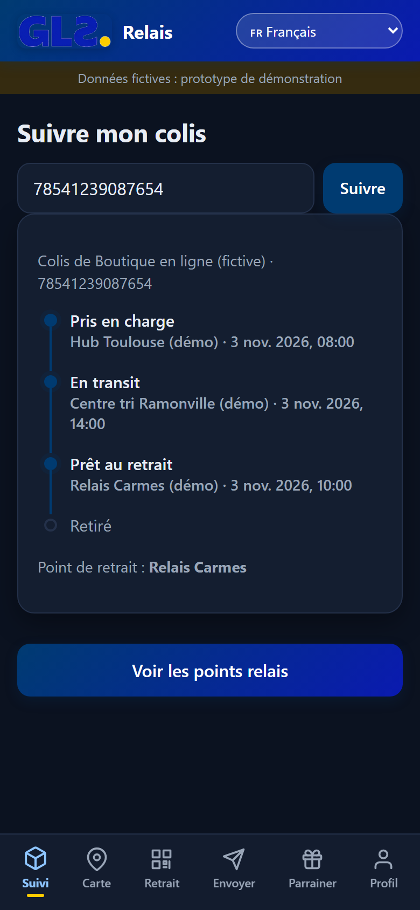
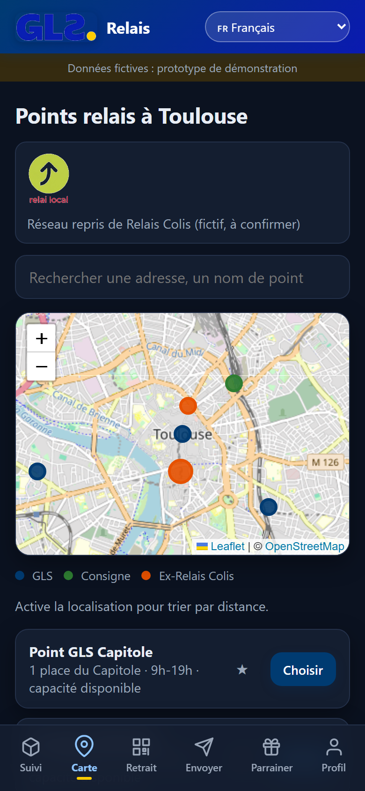
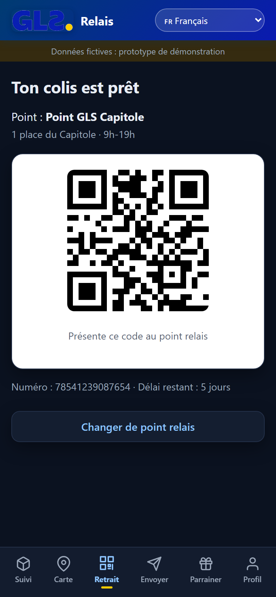
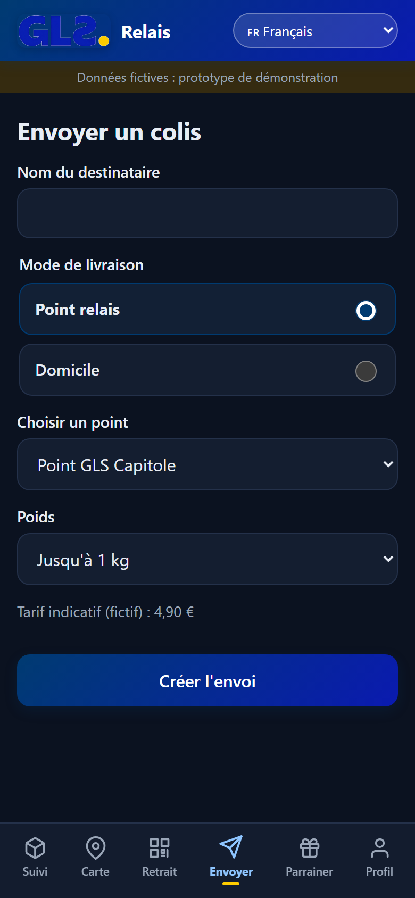
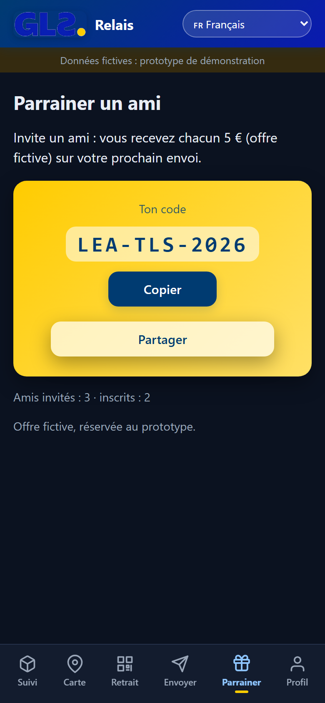
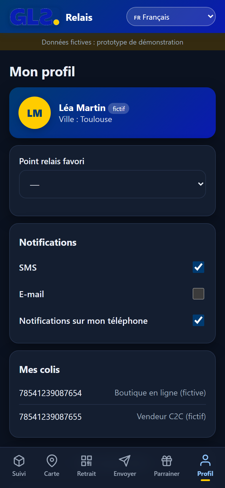
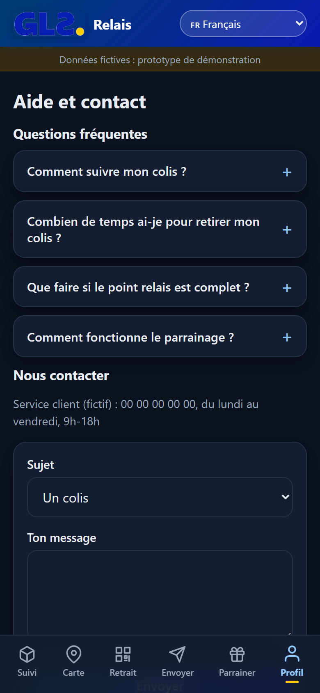
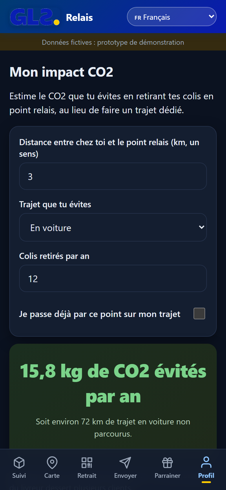

# GLS Relais (démo)

Prototype d'app client pour le retrait de colis en point relais, à Toulouse.
Données fictives : aucun colis ni point réel n'est affiché.

## Aperçu

<table>
  <tr>
    <td align="center"><br><sub>Suivi</sub></td>
    <td align="center"><br><sub>Carte</sub></td>
    <td align="center"><br><sub>Retrait</sub></td>
    <td align="center"><br><sub>Envoyer</sub></td>
  </tr>
  <tr>
    <td align="center"><br><sub>Parrainer</sub></td>
    <td align="center"><br><sub>Profil</sub></td>
    <td align="center"><br><sub>Aide et contact</sub></td>
    <td align="center"><br><sub>Impact CO2</sub></td>
  </tr>
</table>

## Mode d'emploi

1. **Suivi** : saisis un numéro de test, `78541239087654` ou `78541239087655`, puis appuie sur **Suivre**.
2. **Carte** : repère les points relais. Appuie sur **Choisir** pour en sélectionner un. Les points complets sont grisés. L'étoile enregistre ton point favori.
3. **Retrait** : présente le QR code au point relais.
4. **Envoyer** : indique le destinataire, le type d'envoi (relais ou domicile) et le poids, puis appuie sur **Créer l'envoi**.
5. **Parrainer** : partage ton code de parrainage.
6. **Profil** : point favori, notifications, **Aide et contact** (FAQ et formulaire) et **Mon impact CO2**.
7. **Langue** : menu en haut de l'écran, au choix Français, Italiano ou Nederlands.

## Écrans
- **Suivi** : statut d'un colis.
- **Carte** : points GLS, consignes et anciens points Relais Colis (fictifs).
- **Retrait** : colis prêt, QR code de retrait, rappel avant expiration.
- **Envoyer** : création d'un envoi fictif, avec tarif et QR code.
- **Parrainer** : code de parrainage à partager.
- **Profil** : préférences, aide et impact CO2.

## Lancer en local
```bash
npm install
npm run dev
```

## Construire
```bash
npm run build
```

## Documentation
- [Spec](docs/spec.md)
- [Dossier produit](docs/dossier-produit.md)
